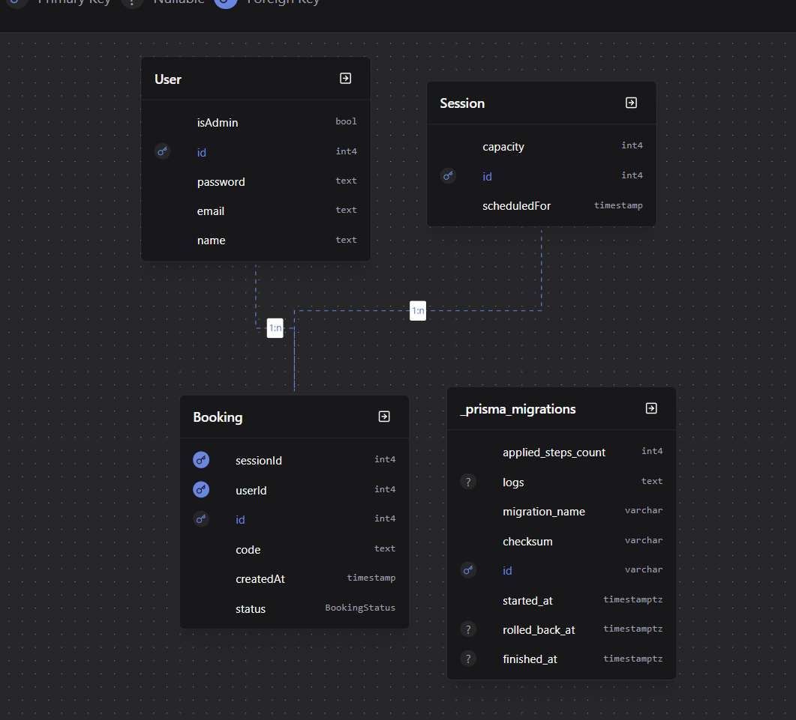

# Gym Slot Booking (GYM-APP)

A full-stack gym session booking web application built for the take-home challenge. Members can browse available sessions, book seats with instant optimistic updates, join waitlists when sessions are full, and check in at the gym using confidential passcodes. Staff manage sessions, view attendee lists, and record attendance.

---

## Deliverables & Live Links

- **Repository URL**: [https://github.com/mahirXsharma/GYM-APP](https://github.com/mahirXsharma/GYM-APP)
- **Frontend Web Application (Deployed on Vercel)**: [https://gym-app-red-mu.vercel.app/](https://gym-app-red-mu.vercel.app/)
- **Backend API (Deployed on Render)**: [https://gym-app-f0ek.onrender.com/api/v1](https://gym-app-f0ek.onrender.com/api/v1)

> **Backend API Access**:  
> All API routes are mounted strictly under `/api/v1`. Accessing the root domain (`https://gym-app-f0ek.onrender.com/`) returns a standard JSON `{"error": "Route not found"}`. Always append `/api/v1` (e.g. `/api/v1/sessions/live`).  
> *Note on Free-Tier Hosting*: Render puts idle instances to sleep after 15 minutes. The initial request may take 30–50 seconds to complete a cold start.

---

## Test Credentials & Seeded Data

The application is pre-seeded with an admin, active members, and scheduled sessions across upcoming days (including at least one full session with a waitlist):

| Role | Email | Password | Responsibilities & Test Capabilities |
| :--- | :--- | :--- | :--- |
| **Admin** | `admin@gmail.com` | `admin@123` | Create 1-hour sessions, view session bookings/attendees, type in passcodes to mark members present. |
| **Member 1** | `test@gmail.com` | `test@123` | Book sessions, view confidential check-in code (`code`), join waitlists, cancel bookings. |
| **Member 2** | `test2@gmail.com` | `test2@123` | Test multi-user concurrent seat reservation, waitlist queueing, and seat releases. |

---

## Design Note

<!-- Ten lines at most, covering stack and data model as requested in challenge requirements -->
1. **Frontend**: React 18 with TypeScript, Vite, Tailwind CSS v4, and React Router v7 for client-side protected routing.
2. **Backend**: Node.js and Express (ESM, TypeScript) with a global error handler preventing stack trace leaks.
3. **Validation & Auth**: Strict server-side Zod validation on all inputs; stateless JWT tokens with bcryptjs password hashing.
4. **Database & ORM**: PostgreSQL database mapped via Prisma ORM with relational schema integrity.
5. **Data Model — User**: Stores user credentials, email (`@unique`), and `isAdmin` flag (admins created via database, not registration).
6. **Data Model — Session**: Hourly slots with `scheduledFor` (`@unique` to avoid overlaps) and default `capacity` of 20.
7. **Data Model — Booking**: Relational join between `User` and `Session` with `BookingStatus` enum tracking lifecycle states.
8. **Data Model — Check-in Code**: Secure, random alphanumeric code (`code`, `@unique`) generated for confirmed bookings.
9. **Concurrency & Capacity**: Atomic database transactions (`$transaction`) guarantee session capacity never exceeds 20 confirmed bookings.
10. **State & UX**: Instant optimistic UI updates with automatic rollback on rejection, paired with polling for live seat updates.

---

## Database Schema



```prisma
enum BookingStatus {
  CONFIRMED
  CANCELLED
  WAITING_LIST
  ATTENDED
  NO_SHOW
}

model User {
  id       Int       @id @default(autoincrement())
  name     String
  email    String    @unique
  password String
  bookings Booking[]
  isAdmin  Boolean   @default(false)
}

model Session {
  id           Int       @id @default(autoincrement())
  scheduledFor DateTime  @unique
  capacity     Int       @default(20)
  bookings     Booking[]
}

model Booking {
  id        Int           @id @default(autoincrement())
  createdAt DateTime      @default(now())
  userId    Int
  sessionId Int
  user      User          @relation(fields: [userId], references: [id])
  session   Session       @relation(fields: [sessionId], references: [id])
  status    BookingStatus @default(CONFIRMED)
  code      String?       @unique
}
```

### WHY? (Data Model & Security Rationale)

1. **Confidential Check-in Code (`code`) on `Booking`**:
   - **Anti-Fraud by Design**: When a booking is confirmed, the server assigns a random, unguessable alphanumeric code (e.g., `8F2A91C4`).
   - **Zero Staff Impersonation**: This code is strictly visible **only to the member** in their app. Admins cannot see this code on the attendee roster. When the member arrives at the gym door, they state their code to the admin, who submits it to `/api/v1/booking/check-in`. This guarantees staff cannot dishonestly mark absent people present.
2. **Slot Uniqueness Constraint**:
   - `@unique` on `Session.scheduledFor` ensures no two sessions can ever share the same start time.
3. **Auditing via `BookingStatus`**:
   - Instead of destructive hard-deletions, statuses transition through `CONFIRMED`, `CANCELLED`, `WAITING_LIST`, and `ATTENDED`. This provides a complete audit trail for gym attendance and waitlist histories.
4. **Relational Integrity**:
   - Foreign key relationships ensure users and sessions maintain referential integrity with zero orphaned bookings.

---

## Assumptions

In accordance with challenge instructions to record all decisions and ambiguities:

1. **Role Provisioning**:
   - Standard registration (`/api/v1/auth/signup`) assigns member status (`isAdmin: false`). Administrative accounts are provisioned directly in the database (`isAdmin: true`) and cannot be created through public signup.
2. **Session Timing & Duration**:
   - All gym sessions start exactly on the hour and last for one hour. Sessions cannot overlap.
   - Admins define the date, starting hour, and capacity (defaults to 20).
3. **Waitlist & Automatic Promotion**:
   - When a session reaches 20 confirmed bookings, members can join its waitlist (`WAITING_LIST`).
   - A member can only be on the waitlist once per session and can voluntarily leave it.
   - When any confirmed booking is cancelled prior to session start, an atomic transaction immediately promotes the earliest waitlisted member (`orderBy: { createdAt: "asc" }`) to `CONFIRMED`, generating a fresh check-in code.
   - If a session has already started, no waitlist promotions occur.
4. **Check-In Window & Code Validity**:
   - A check-in code is single-use and valid strictly during the session's active 1-hour window (`now >= sessionStart && now < sessionEnd`).
   - Cancelled or already-attended bookings cannot be checked in.
5. **Concurrency & Seat Guarantee**:
   - Booking requests run inside an atomic Prisma transaction (`$transaction`). If two members attempt to reserve the final 20th seat simultaneously, the first to commit receives the confirmed booking, and the second is safely rejected with `409 Conflict` (or invited to the waitlist).
6. **Data Privacy & Ownership**:
   - Members can query only their own bookings. Admins have access to the complete session roster.
   - Admin view displays attendee names, emails, and booking statuses, but explicitly omits check-in codes and user IDs.
7. **Client-Side Real-Time Updates**:
   - Real-time seat synchronization uses periodic polling rather than WebSockets to ensure high compatibility and reliability across serverless/container deployments.

---

## API Endpoints & Status Codes

The API returns consistent JSON responses and follows standard HTTP status codes:
- **`200 OK` / `201 Created`**: Successful operation.
- **`400 Bad Request`**: Malformed input or validation error (validated via Zod).
- **`401 Unauthorized`**: Missing or invalid JWT authentication token.
- **`403 Forbidden`**: Role check failure (e.g. non-admin accessing admin route, or cancelling someone else's booking).
- **`404 Not Found`**: Target session or booking not found.
- **`409 Conflict`**: Conflict (e.g. session full, duplicate booking, already on waitlist).
- **`500 Internal Server Error`**: Global error handler prevents crashes and suppresses stack traces.

### Endpoints Table

| Method | Endpoint | Access Level | Description |
| :--- | :--- | :--- | :--- |
| `POST` | `/api/v1/auth/signup` | Public | Register new member (`name`, `email`, `password`) |
| `POST` | `/api/v1/auth/login` | Public | Authenticate user, returns JWT token and profile |
| `GET` | `/api/v1/sessions` | Authenticated | Browse sessions with remaining seat counts |
| `GET` | `/api/v1/sessions/live` | Authenticated | List available active and future sessions |
| `GET` | `/api/v1/sessions/live/:id` | Admin Only | View session bookings roster (hides confidential codes) |
| `POST` | `/api/v1/sessions` | Admin Only | Create new session (`scheduledFor`, `capacity`) |
| `POST` | `/api/v1/sessions/:id` | Authenticated | Book a seat (or join waitlist if full) |
| `GET` | `/api/v1/booking` | Authenticated | Get current member's bookings & check-in codes |
| `DELETE`| `/api/v1/booking/:id` | Authenticated | Cancel booking (triggers automatic waitlist promotion) |
| `POST` | `/api/v1/booking/check-in` | Admin Only | Submit member's passcode to mark `ATTENDED` |

---

## Local Development Setup

### Prerequisites
- Node.js (v18+)
- PostgreSQL database (local or cloud instance like Supabase/Neon/Render)

### Environment Variables
Only the backend requires environment configuration:
- `backend/.env.example`

> **Note on Frontend (Zero-Config)**: No `.env` setup is needed for the frontend! It uses URL rewrites and proxies:
> - **Local Development**: Vite automatically proxies all `/api` calls to `http://localhost:3000` via [vite.config.ts](file:///c:/Storage/WEB%20DEV/FRONTEND/REACT/Projects/GYM-APP/frontend/vite.config.ts).
> - **Production (Vercel)**: Vercel seamlessly rewrites `/api/*` requests to the live Render backend via [vercel.json](file:///c:/Storage/WEB%20DEV/FRONTEND/REACT/Projects/GYM-APP/frontend/vercel.json).

### 1. Backend Setup
```bash
cd backend
npm install

# Create .env from template
cp .env.example .env
# Edit .env with your DATABASE_URL, JWT_SECRET, and PORT

# Apply Prisma migrations and generate client
npx prisma generate
npx prisma db push

# Start backend server
npm run dev
```

### 2. Frontend Setup
```bash
cd ../frontend
npm install

# Start frontend application (no .env file required)
npm run dev
```
Open [http://localhost:5173](http://localhost:5173) in your browser.